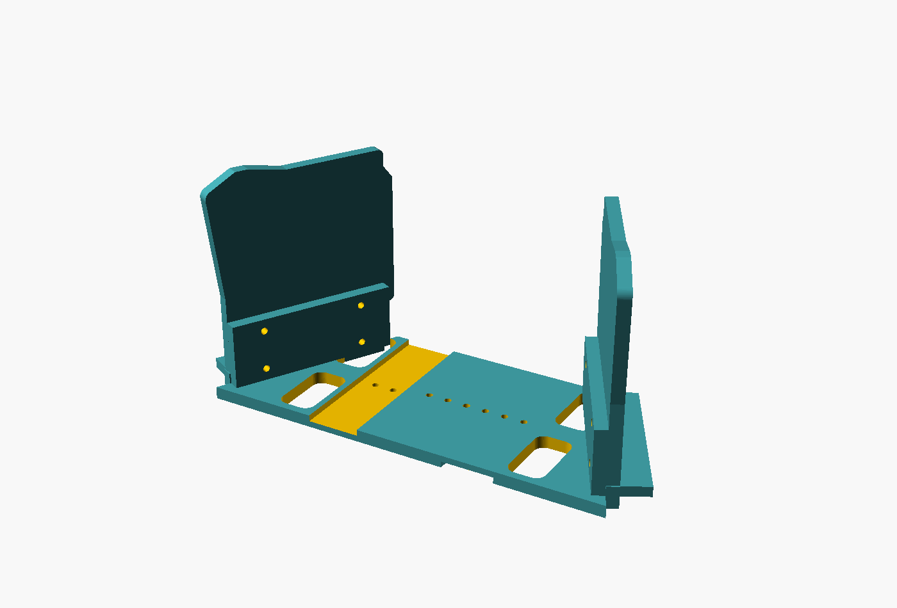

# charybdis-tent

A fork of [josephdcaputo/microdox-tent](https://github.com/josephdcaputo/microdox-tent),
retargeted from the Boardsource Microdox v2 to a **Bastard Keyboards Charybdis**,
and from a tenting wedge to a **fully vertical stand**.

Upstream gives us the architecture this needs: one printed stand per half that the
keyboard screws onto, plus a printed spacer that locks the two halves at a chosen
spacing and splay so they behave as one board — all from a single parametric
OpenSCAD file, with collision checking between the stands, the spacer and both
keyboard halves.

What changes here is the angle, the target board, and the fact that the whole thing has to
work on a lap and then go in a bag. The angle turned out to change the architecture with it:
at 90° a wedge is simply the wrong shape, and the stand becomes a bookend. The spine does not
change — see *What's in here* below.

---

## What's in here

| | |
|---|---|
| `cad/microdox_ribs.scad` | Upstream's wedge stand, 20–35°. Unchanged apart from a comment on why 35° is the ceiling. |
| `cad/vertical.scad` | **The 90° stand.** Two walls and a splayed spine, plus the rest kit. |
| `cad/pad_ring_ref.scad` | The gel-pad bezel's outline, sliced from BastardKB's own mesh. |
| `stl/stands/`, `stl/joint/` | Upstream exports: wedge stands at 20–35°, and the spacers and couplers. |
| `stl/vertical/` | Exports of the 90° stand. **Microdox hole pattern — a geometry proof, not parts to print.** |
| `tools/` | Upstream's rib print-angle checker and the stability model. |

### The architecture, and why it changed twice

The first attempt at 90° gave each half a 139 × 105 mm base plate. That was wrong in a way
worth recording, because the mistake is easy to repeat: the plate was **62% of each half's
mass**, and it put all the structure *outboard*, under the hands, while leaving the ~160 mm
of air between the two vertical halves completely empty.

At 90° that gap is dead space. No hands, no keycaps, no cables. It is the only place
structure doesn't get in the way, and the structure was on the wrong side of the keyboard.

So everything moved inboard:

| part | job |
|---|---|
| `wall` ×2 | Flat plate. Board bolts to its outer face; bottom edge stands on the desk. |
| `spine_left` / `spine_right` | Flat plate between the halves, with an upturned flange at its outer end that the wall bolts to face-to-face. Half-lapped in the middle and bolted through a hole row. |

No base plates, no braces, no feet. A bolted face-to-face lap is already a moment
connection, and the wall's own bottom edge takes the vertical load straight to the desk.

### Why the wedge file couldn't just take a bigger number

The Ribs stand is a wedge, and a wedge does not become a bookend by turning a knob.
`plate_in_x()` falls from ~87 mm at 30° to `plate_t` (3 mm) at 90°, `foot_x()` goes negative,
and the wishbone ribs invert through the plate. The `tent_deg` assert in that file is a real
structural limit, not a cautious one. 36–89° is unexplored territory: neither file covers it.

### Splay lives in the printed flange

The flange on each spine half is rotated by half the splay angle, so the wall bolted to it
comes out splayed and **nothing has to be aimed by eye at assembly**. That is deliberate:
splay is the one measurement that cannot be rediscovered by feel in ten minutes, so it should
be impossible to get wrong when reassembling in a café. Distance is the thing you adjust.

Sign follows `place_half()` in `microdox_ref.scad`: positive `splay_deg` converges the halves
away from you. If the tracing disagrees, pass a negative value rather than editing the code.

### Distance: a half-lap, not a spacer set

The two spine halves are relieved to half thickness over their inner 70 mm, on opposite
faces, so they interlock to full thickness and bolt through a shared hole row. One part type
per hand, nothing loose to carry or lose.

The catch, which the file asserts on: **the gap is not freely settable.** The two rows run in
opposite directions, so holes only meet where `h1 + h2 == gap`. At the defaults that leaves
**136, 146, 156, 166 and 176 mm**, and the assert prints the list if you ask for anything
else. Default is 156 mm, which lines up three bolt positions.

This replaces the dovetail spacer system for the vertical stand. The dovetail still works and
is still proven, but it needs a 12 mm tongue bar and a bag of spacers; the lap needs neither.

### Current numbers

| | |
|---|---|
| Core, 2 walls + 2 spine halves | **98 g** (the base-plate design was 172 g) |
| Rest kit, 2 carriers + 2 arms | **65 g** (`pads-base` alone was 51 g each, 102 g the pair) |
| Everything | **163 g**, roughly €8 of filament at €0.05/g, plus machine time |

Footprint is about 160 × 95 mm, nearly all of it in the dead space between the halves,
against 318 × 105 mm before. Every part is a flat plate or a plate with one upstand, so they
nest: turn one of each pair end-for-end and the flanges and lips sit at opposite ends.

### Board retention: a lip and two bolts, with different jobs

The **lip** is a shelf along the bottom of the wall that the board's lower edge sits on. It
carries the weight in compression against a surface, which printed plastic is good at.

The **bolts** only stop the board leaving — lifting off, or being pulled outward by working
the trackball, which is a real force on the right half and the reason a tray alone won't do.
Because the keys face outward at 90°, every keypress pushes the board *into* the wall, so in
normal typing the bolts carry almost nothing.

Clearance holes are cut at all five mount points; use whichever two or three of yours line
up. This also means the bolt pattern only has to be *approximately* right to be useful,
which takes some of the risk out of the pencil rubbing.

### Rest kit

The upstream wrist rest is a four-part chain: a modified bottom plate, `pads-arm` (a 36 × 8
× 62 mm blade, ~5 g), `pads-base` (a hollow kidney 28 mm tall, ~51 g) and `pads-holder` (the
bezel that traps the gel pad). Drupchen kept only the bezel.

That bezel is 120 × 83 × 10 mm and has **no screw holes, no tabs and no bosses** — it exists
only to clamp the pad's rim. Dropping the body dropped the only part with a mounting
interface, which is why the rest is currently twist-tied to the mesh.

| part | |
|---|---|
| `carrier` | Replaces `pads-base` at 20 g instead of 51. Flat tray, with a recess the bezel drops into. The outline is **sliced from the bezel's own mesh**, not fitted to a guess — see `cad/pad_ring_ref.scad`. |
| `rest_arm` | A plain blade with a hole row at each end: one bolts up into the carrier floor, the other goes wherever the rest turns out to belong. |

`rest_lift` is 0 by default, making the carrier a flat tray. At 90° the hand almost certainly
meets the board higher than it did at 58°, so it probably needs raising — but by how much is
an open question below, and a wrong guess is a reprint. Raise the parameter and the tray
grows a thin open skirt; even lifted it stays far lighter than the original body, because the
walls are 3 mm and the bottom is open.

The arm is deliberately **not** committed to a fixing point on the stand. Where it attaches
depends on the same unmeasured rest position, and the rest may well be better left detached
anyway: at 90° a 120 × 83 mm rest hanging off each half roughly doubles the footprint, and in
a reclining chair the rest and the keyboard may want to move independently.

---

## Why this fork exists

The keyboard currently sits on a folding wire grid table resting on my legs in a
zero-gravity recliner. The halves are held by the upstream Charybdis *modular
adjustable tenting stand* (hinged voronoi plates, slotted steel strut dropping into
a ratchet rail), and the whole assembly — stands and palm rests both — is lashed to
the wire mesh with twist-ties.

It works. Nothing moves. But:

1. **The tent angle was capped by the rig, not chosen.** 58° was the steepest the strut
   reached while the base stayed on the grid — a ceiling, not a preference. It has since
   been taken all the way to vertical, which the rig only just allows and cannot hold
   well. *(Resolved: see below. The rest of this list still stands.)*
2. **It isn't portable.** The grid table folds but won't go in a bag, and without it
   the geometry is gone: splay, spacing and rest position all live in twist-ties.
3. **The geometry isn't recorded anywhere.** If the rig were knocked apart, the splay
   in particular would take weeks to rediscover by trial and error.

The goal is to turn the geometry into a file and a set of parts.

---

## Measurements

### Tent angle — 90°, settled

**The board is vertical.** Set there, typed on, kept.

This is the end of the range rather than a step along it. At 90° the forearm is in true
neutral — the handshake position — and pronation is zero. Past vertical the forearm would
begin to supinate, which has costs of its own. There is no steeper setting to go looking
for, and that is exactly the condition a single print needs: the angle question is closed
before anything is cut.

At 90° the outer (USB, pinky) edge sits at the bottom and the inner (thumb) edge at the top,
so the keys face **outward**, away from the other half, and the hands come in from outside.
This matters more than it sounds — it decides which way every force points. See *Stability*.

#### The previous setting, kept for the record

Before going vertical the rig sat at ~58°, measured with a phone level app (accelerometer,
not the compass — the compass is useless this close to a steel wire rack). The phone was held
flat against the **base plate of each half**, which is the plane the tenting mechanism
actually controls, with a vertical plane between the halves as the 0° datum.

| | off vertical | from horizontal |
|---|---|---|
| Left half | 31° | 59° |
| Right half | 33° | 57° |
| **Mean** | **32°** | **~58°** |

Opposite signs, so the halves rolled toward each other as expected. Retained here only
because the 2° asymmetry below was measured from this setting, and because the reasoning
in *The 30° mismatch* depends on it.

### Stability

At 90° the keys face outward, so **a keypress pushes each half inward**, toward the other.
The halves lean on the spine between them and the spine takes the load in compression.

This is the opposite of the wedge case, and it is the reason the project survives the angle
change. `docs/check_results/stability.txt`, generated from this repo's own geometry, shows
the restoring moment of a lone wedge-mounted half collapsing as it steepens:

| tent | lone half rocks at | tips over at |
|---|---|---|
| 20° | 101.3 N | never |
| 25° | 11.3 N | never |
| 30° | 5.5 N | 17.7 N |
| 35° | 3.4 N | 6.8 N |

A keypress is roughly 0.6 N, bottoming out perhaps 1.5 N. Extrapolated to 90°, a free half
has essentially no restoring moment at all. So the spine stops being a convenience that holds
splay and becomes **the thing that stops the keyboard falling over**. One half of this must
never be stood up on its own, and the spine has to be rigid in compression rather than merely
a spacer that sets a distance.

### Splay

Measured from a top-down photo against the wire grid, using two straight sticks laid
along the inner edges of the foot plates.

- **~28° per side** from the fore-aft axis
- **~56° included** between the halves

Confidence: moderate, and now **stale** — this was measured at 58°, and going vertical
very likely moved it. Re-measure before cutting the spine flanges, by counting grid squares:
lay a stick along a plate edge, count squares across versus along, `atan(across/along)`.
Integer counts, no measurement error.

With the tent settled, this is now the number most worth recording. The tent angle could be
rediscovered by feel in ten minutes; a 56° splay could not.

### Symmetry

A **2° left/right difference** has shown up twice, from two different sensors
measuring two different physical quantities:

- Magnetic headings against a midline reference: 61° and 59°
- Level readings off vertical: 31° and 33°

Unlikely to be coincidence in both. Still undecided whether this is a real asymmetry
worth preserving or accumulated drift in the ratchet that I've adapted to.
Test: swap the halves left-for-right and see whether one side suddenly feels wrong.

Both readings are from the 58° rig, and both are tent measurements, so **going vertical
settles this by itself**: at 90° there is no ratchet tooth left to drift, and both halves
are at the same hard stop. If one side still feels wrong now, the asymmetry is real and
lives in the splay or the rest position, not in the tent.

### Hand posture

- Full **handshake orientation** — hand close to vertical, forearm supported on the
  chair's armrest, pronation essentially eliminated.
- Heel of the palm rests on a **rocking support**: printed cradle, glass dome, ribbed
  foam grip on top. The dome is a deliberate pivot, letting the hand rotate as the
  fingers move between columns. Nothing bounds its travel, which is the one thing
  about it worth fixing.
- **Float test passes**: I can lift the hand clear of the rest and type the home row
  with no change in finger reach. So the rest is a locating surface, not a load path —
  the forearm's weight goes into the armrest, not into the heel of the palm.
- **The pinky is held stretched backwards.** This is the open ergonomic problem.

### The 30° mismatch — closed

Hand at ~90°, board at 58°. Something had to absorb the difference, and it was the fingers.
Index through ring were flexing, which they're built for. The little finger can't, so it
extended backwards instead and stayed there.

Taking the left half steeper (it has no trackball to fall out) noticeably eased the tension.
That was the evidence that 58° was too shallow, and it is what the move to 90° acted on.

**Going vertical removes the mismatch at its source.** Whether it also removes the pinky
stretch is now a live question with a clean answer either way: if the stretch persists at
90°, the tent angle was never the cause, and only rest position and keymap remain.

### Trackball retention

The stock top adapter does not retain the ball at all. Measured off the upstream STLs:

| | stock `adapter_v4_v4_top.stl` | `mods/trackball_retainer/4x6/trackball_retainer.stl` |
|---|---|---|
| Footprint | 45.60 mm | 45.60 mm |
| Mounting face | −19.00 | −19.00 |
| Top face | −1.00 | **+2.00** |
| Narrowest point above the ball | **35.00 mm** | **33.50 mm** |

Every cross-section below the stock top face is numerically identical between the two
files — the retainer is literally the stock part with 3 mm added.

A 35.00 mm aperture against a 34 mm ball means a full millimetre of clearance: the ball was
never held, only rested. At 58° it was marginal, unseating from one of its lower contact
points.

**At 90° the retainer stops being an upgrade and becomes a prerequisite.** The socket now
faces sideways, so the ball is held by nothing but whatever part of the rim happens to sit
beneath it — and an aperture wider than the ball holds nothing at all. Fit the retainer
before standing the right half up.

Ball diameter is **34 mm**, which is settled rather than measured: it passes through the
stock 35.00 mm aperture, so it is under 35, and 34 mm is the stock Charybdis size. An earlier
photo-based estimate of ~42 mm was wrong — the boxes it was wedged between weren't vertical.

The retainer's 33.50 mm aperture is smaller than the ball, so the equator cannot pass.
In normal use the ball's width at that height is only ~29 mm, so it's a hard stop rather
than a squeeze. **At steep tent that changes** — gravity presses the ball against the
rim continuously, so expect rim contact and some drag. Upstream's own notes say rotation
feels stiff at first and eases with use.

Note: upstream says the retainer's height is tuned for the `static-bearing-screws` mod, not
the stock bearings. The socket has **three** bearings, which is stock — an earlier count of
six came from a dark photo and was wrong — so height is the one thing left to check before
trusting the fit.

Worth printing on its own, ahead of everything else: it is a few grams, so a euro or two with
machine time, and it shows how the shop's printer handles a part with one tight functional
dimension before anything expensive is committed.

---

## Requirements

### Must

- Work on a **lap**, in a reclined zero-gravity chair, not only on a desk.
- Capture **tent, splay and inter-half distance** repeatably — set it down, pick it up,
  same geometry.
- **Pack flat** and fit in a bag.
- Hold the halves **vertical (90°)**, well beyond upstream's 20–35° range.
- Work with the trackball retained at that angle.
- Be **rigid between the halves**, not merely spaced — at 90° the spine carries the
  keypress load and is what keeps the assembly upright.

### Should

- Carry the **palm rests** as part of the geometry. Where the palm pivots sets where all
  four fingers land; leaving the rests behind loses the setup, not just a comfort item.
- **Feet that do both jobs** — pegs that drop into the wire mesh for positive location at
  home, and a flat pad for a table when away.
- Nothing held by **friction**. Pinned, slotted or bolted only, so nothing creeps.

### Constraints

- **No 3D printer.** A print shop in Lousã, charging by weight and machine time at roughly
  €0.05/g (≈€20 for a ~400 g part). So: flat plates, not solid wedges — a fraction of the
  Z height and roughly half the material. Web everything out.
- **One print job.** All prototyping happens in cardboard first; the printed version is a
  transcription of something already proven.
- **PETG, not PLA.** The parts carry the keyboard's weight continuously once tented, and
  PLA creeps under sustained load.

### Explicit non-requirements

- **No adjustment mechanism.** The angle is 90° and there is nothing steeper to adjust
  toward, so the printed part is a single fixed angle — lighter, stronger, cheaper and
  simpler than detents or bolt arrays. Adjustability was only ever a workaround for not
  knowing the answer. Inter-half distance stays adjustable, via the spine's hole row.
- No need to print a lap deck. The grid table at home, a table away, or a thin plywood or
  acrylic sheet — the deck is interchangeable and the printed parts carry only the geometry.

---

## Hardware as built

- Charybdis, built from the upstream BastardKB STLs, apparently unmodified except for the
  tenting base. Sourced cheaply; the printed parts are stock files.
- Stock trackball top adapter in place (`adapter_v4_v4_top.stl` / `adapter_v2_top_v75.stl` —
  identical bounding boxes). Removable, which means a full 360° capture ring is viable and
  removing it is how the ball gets cleaned.
- Current tenting: upstream modular adjustable tenting stand, angle set by which ratchet
  tooth the strut's fork sits in, held there by a twist-tie. Now run **vertical**, which is
  at or past what that mechanism was meant to hold — the halves stand up, but the rig is
  working at its limit and the geometry is no longer repeatable by tooth count.
- Palm rests: printed peanut-shaped cradle, glass dome, ribbed foam grip, twist-tied to the
  mesh.

---

## Open questions

Ordered by how much they block the design.

1. **Does 90° hold up over a full working day?** It has been typed on and liked, but the
   symptoms this project is chasing are hours-scale and a wrong angle feels fine for the
   first few minutes. Nothing should be cut until a long session has confirmed it. This is
   the one question that could still invalidate the design.
2. **Is the pinky stretch caused by the tent, the rest position, or the keymap?** The tent
   is now at its limit, so that candidate is spent: if the stretch is still there, it was
   never the angle. Remaining tests are moving the rest forward or outward, and remapping
   whatever key the little finger reaches for.
3. **Where do the palm rests go at 90°?** The rest positions were set for a 58° board and
   are almost certainly wrong now. At 90° the key field is at its tallest, and the rest is
   what decides where the hand meets it. Re-trace before cutting.
4. **Real asymmetry or ratchet drift?** Decides whether this is one mirrored part or two
   distinct ones. Easier to settle now: the ratchet is no longer in the path.
5. **Does the upstream trackball retainer fit this socket?** Ball diameter and bearing count
   are settled; only the retainer's height against stock bearings is unverified.

### Still to measure

- **Bolt pattern on the case bottom plate** (requires opening the keyboard). This is the one
  blocking measurement: `cad/vertical.scad` is still built on the Microdox hole pattern and
  cannot be printed for a Charybdis until this is known. A pencil rubbing of the bottom plate
  gives a 1:1 template with no arithmetic.
- **Splay, re-measured at 90°** — the recorded ~28°/side is from the 58° rig
- **Palm rest positions at 90°**, in grid squares from a common corner
- **Height of each half's bottom edge above the deck** — at 90° the key field is at its
  tallest, and this sets where the hands have to be
- **Case thickness at the board's bottom edge** — sets `lip_reach`; measurable with the case shut
- **Rest height at 90°** — sets `rest_lift`; 0 for now, which is almost certainly too low
- Bearing diameter (count is three, confirmed)
- Wire grid pitch and wire diameter
- Print shop bed size and exact per-gram rate

### Method note

Before dismantling anything, **trace the current layout**: lay cardboard over the grid, put
both halves and both rests in position, draw around all four, mark the inner corners. That
single tracing captures splay, spacing and rest position at once, with no angles and no
arithmetic — and it becomes the baseplate template directly. Once the halves come off the
grid, that information is gone.

Do this again now that the board is vertical. The tracing on file was taken at 58°, and the
three things it captures — splay, spacing, rest position — are exactly the three most likely
to have moved. At 90° the footprint of each half is also much narrower, so the old outline no
longer describes what sits on the deck.

---

## Changes planned against upstream

| | upstream microdox-tent | here |
|---|---|---|
| Target board | Microdox v2 | Charybdis |
| Tent range | 20–35° | 90°, fixed |
| Stand shape | ribbed wedge | bookend: two walls on a spine, no base plates |
| Mounting | replaces stock 2.0 mm bottom plate | lip carries the weight, two bolts stop it leaving (pattern not yet measured) |
| Construction | printed ribbed stand | flat plates, bolted, for cost and packing |
| Spine | dovetail spacer set, sets spacing and splay | half-lapped pair; splay printed into the flange, distance on a hole row — and now structural |
| Wrist rest | 4-part chain, `pads-base` 51 g | flat carrier, 20 g, profile sliced from the bezel's own mesh |
| Surface | desk | lap deck, wire mesh, or table |
| Transport | — | comes apart, packs flat |
| Palm rests | not addressed | carried on the spine |
| Trackball | n/a | needs retention at steep tent |

The spacer geometry and the collision checking are the parts worth keeping as-is — they're
the hard bit, and they're already solved.

---

## Credits

- [josephdcaputo/microdox-tent](https://github.com/josephdcaputo/microdox-tent) — the stand
  and spacer architecture, and the parametric OpenSCAD implementation this forks.
- [Bastard Keyboards](https://github.com/Bastardkb/Charybdis) — the Charybdis itself, the
  modular adjustable tenting stand, the trackball retainer mod, and
  `files/mods/tenting-stand-with-wrist-pads`, whose `pads-holder` bezel the carrier in
  `cad/vertical.scad` is built around. CC BY-NC-SA 4.0.

Worth reading before cutting anything:

- [rgoulter/keyboard-labs](https://github.com/rgoulter/keyboard-labs) — `keyboard_tenting_stand.scad`,
  a laser-cut parametric tenting stand. Laser-cut means flat plates, which is both the
  cost-efficient print and the thing that cuts directly in cardboard.
- [AlSpheric's Iris stand](https://github.com/Ivaan/shapes/tree/master/IrisKeyboardStand) —
  parametric, generated from a list of plate screw coordinates, so it retargets to any split
  board with top/bottom plates and standoffs.
